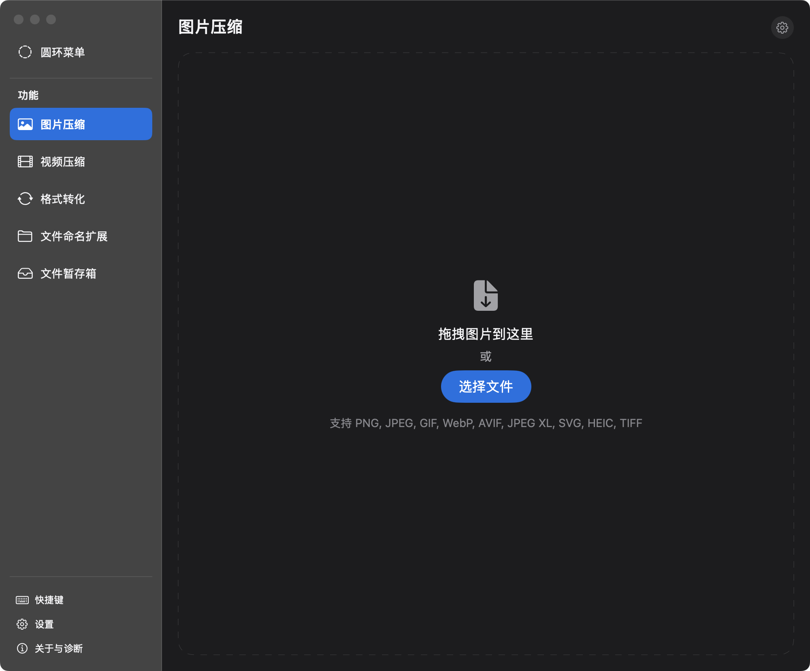
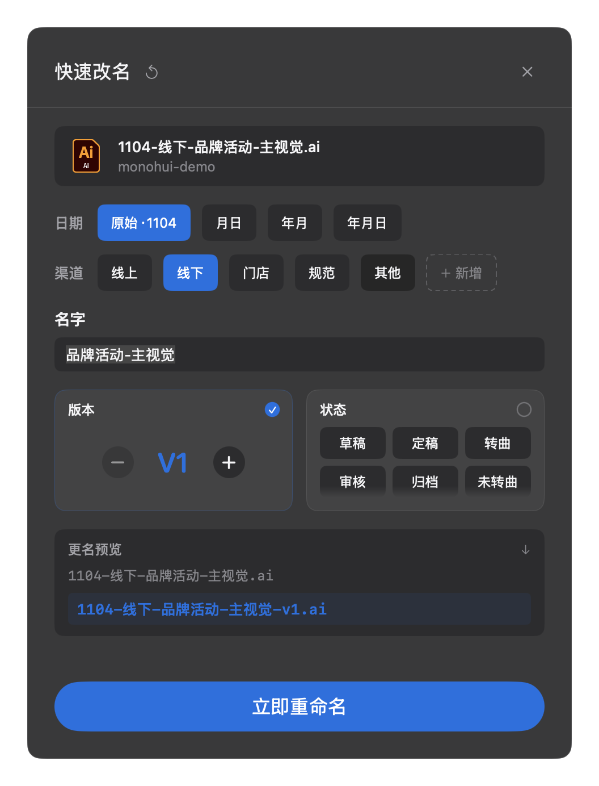

  

<h1 align="center">MonoHui-Kit · 快捷右键</h1>

  给 Finder 补上它本来就该有的那些操作。 
  选中文件，右键或按一个快捷键：压缩、转码、改名、建日期文件夹、转格式，全部在本机完成。

  
  
  
  
  

---

## 这是什么

macOS 的右键菜单能对文件做的事很少。MonoHui-Kit 是一个常驻菜单栏的小工具，专门补「选中 → 处理」之间被省掉的那几步：不用打开任何 App，不用把文件拖进窗口，选好文件按下快捷键就开始干活。

- **三个入口**：右键 → 服务、全局快捷键、按住即出的圆环菜单，同一个动作在哪都能触发
- **不联网也能用**：压缩、转码、改名全在本机跑；除非你主动检查更新，它不会发任何请求
- **零外部依赖**：内置压缩工具链，不需要装 ImageMagick / ffmpeg / Homebrew，安装包 15MB

## 界面

<table>
  <tr>
    <td width="50%"></td>
    <td width="50%"></td>
  </tr>
  <tr>
    <td align="center">主窗口：六个功能模块，快捷键与设置收在底部</td>
    <td align="center">快速改名：把文件名拆成日期 / 渠道 / 版本 / 状态，逐段改</td>
  </tr>
</table>

## 功能

| 功能 | 做什么 | 入口 |
|---|---|---|
| **图片压缩** | PNG / JPEG / GIF / WebP / AVIF / JPEG XL / SVG / HEIC / TIFF 互转与压缩；无损或按 100 / 90 / 75 / 50 / 20 质量档；已压过的文件自动跳过 | 右键 · `⌥⇧C` 快速 / `⌥⇧I` 选参数 |
| **视频压缩** | 质量三档 × 分辨率四档 × H.264 / HEVC，走 VideoToolbox 硬件编码，体积没变小会自己回滚 | 右键 · `⌥⇧V` |
| **快速改名** | 按 `日期-渠道-名称-版本[状态]` 的约定拼文件名，实时预览，支持批量与自定义标签 | 右键 · `⌘R` |
| **新建日期文件夹** | 一键建 `yyMM` / `MMdd` / `yyMMdd` 文件夹；弹窗版可选渠道、填名称、顺手把选中文件移进去 | 右键 · `⌥⇧N` |
| **格式转化** | 图片与文档按预设转换，规则可按 App 记忆 | 侧栏 |
| **文件暂存箱** | 屏幕左缘热区拖入即存，跨 App 中转；按应用规则自动转格式，退出时按策略放回原位或进回收站 | 侧栏 · 左缘热区 |
| **圆环菜单** | 按住 `⌥⇧R` 在光标处唤出圆环，移动选择、松手执行，不新增任何系统权限 | 快捷键 · `⌥⇧R` |

> 快捷键都是默认值，可在「快捷键」页自己录。所有功能只在 Finder 是前台时注册，不会和别的 App 抢组合键。

## 安装

到 [Releases](https://github.com/CXH888888/MonoHui-Kit/releases/latest) 下载最新的 `MonoHui-Kit-vX.Y.Z.dmg`，双击挂载，把 App 拖进「应用程序」。

第一次打开会被 Gatekeeper 拦下（应用没有 Apple 开发者签名）：

1. 右键点 App → **打开**，或到「系统设置 → 隐私与安全性」点 **仍要打开**
2. 打开后进 **设置 → 服务菜单**，点「全部安装」注册右键菜单
3. 按需授权：**辅助功能**（建完文件夹自动进重命名）、**通知**（完成提示）。不授权也能用，只是少这两个便利

从源码构建、部署脚本、签名证书的做法见 [docs/DEVELOPMENT.md](docs/DEVELOPMENT.md)。

## 怎么用

**右键**：Finder 里选中文件 → 右键 → 服务 → `图片·快速压缩`、`文件夹·新建-年月`……菜单按 `图片·` / `文件夹·` 前缀自动聚在一起。

**快捷键**：设置里打开「全局快捷键」总开关，之后在 Finder 选中文件直接按组合键，连右键都省了。

**圆环**：按住 `⌥⇧R`，光标处淡出圆环 —— 八个扇区各放一个动作，移到哪个就高亮哪个，松开修饰键执行，按 Esc 取消。

**窗口**：也可以直接开 App，侧栏切模块，拖文件进去处理。

## 隐私

- 图片、视频、文件全部在本机处理，**不上传、不联网**
- 唯一的网络请求是你点「检查更新」时访问 GitHub Releases
- 不需要输入监控权限：圆环菜单靠轮询鼠标位置与修饰键状态实现，没有装 `CGEventTap`
- 日志只写本地 `~/.monohui-kit/logs/app.log`，不收集任何使用数据

## 系统要求

- macOS 14 Sonoma 及以上
- 当前分发包是 **arm64（Apple Silicon）**；Intel 机型需要自行编译

## 常见问题

**右键菜单里找不到服务项**
装完服务菜单后系统需要几秒刷新缓存。没出现的话在设置页点一次「全部安装」，或 `killall Finder`。仍然不行就重新登录一次。

**快捷键按了没反应**
快捷键只在 Finder 是前台应用时生效（故意的，避免抢别人的组合键）。确认 Finder 处于最前，且设置里「全局快捷键」总开关是打开的。

**升级后辅助功能权限失效**
ad-hoc 签名会让系统把每次更新当成新 App。本项目用固定的本地证书签名，正常升级不会掉权限；如果你是自己编译的，先跑一次 `bash scripts/setup-signing-cert.sh`。

**压缩完体积没变小**
视频压缩遇到「压完反而更大」会自动删除产物并提示源文件已足够紧凑；图片请改用无损 / 更低的画质档。

## 相关文档

- [docs/FEATURES.md](docs/FEATURES.md) — 每个功能的完整规格：入口、参数、边界行为
- [docs/DEVELOPMENT.md](docs/DEVELOPMENT.md) — 构建部署、架构、进程模型，以及 17 条踩坑记录
- [CHANGELOG.md](CHANGELOG.md) — 逐版本变更
- [CODE_MAP.md](CODE_MAP.md) — 代码地图：文件职责与主要链路

## 许可

暂未声明开源许可证。代码公开供参考与学习；如需商用或分发，请先开 issue 联系。
